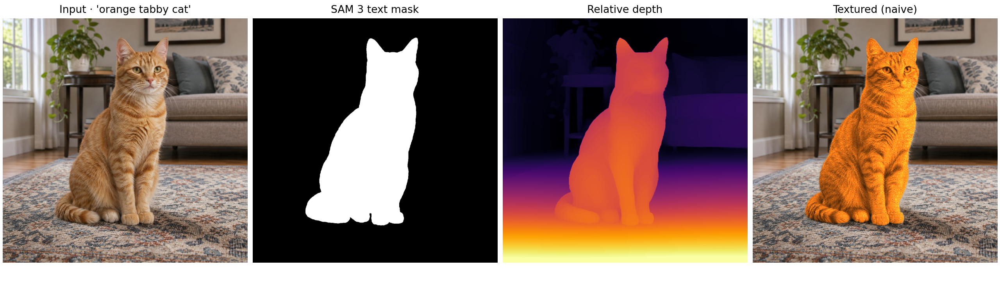
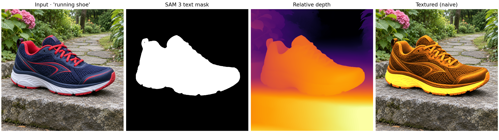
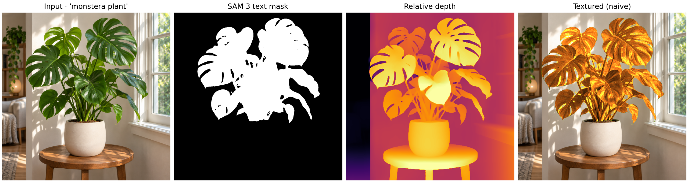
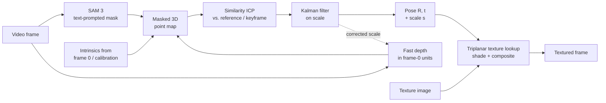

# Wrapping Objects in New Materials, Live

*CS 180 final project · checkpoint proposal · [team names]*

## The idea

We want to take a video, name an object in it ("the running shoe"), hand over a picture of a material (orange peel, brick, denim), and get back the same video with that object made of the new material. The texture should bend around the object's shape, turn with it as it rotates, and stay attached from frame to frame, while everything else in the video stays untouched. We also want it fast enough to run live on a camera feed.

## How it is done today

Style transfer for video (Ruder et al., 2016) restyles the *entire* frame toward a painting and cannot single out one object. Layered Neural Atlases (Kasten et al., 2021) and CoDeF (2024) get consistent object edits by training a per-video model that unwraps the object into a flat 2D canvas. Edits painted on the canvas follow the object, but each video needs minutes to hours of training, and the canvas is a 2D mapping: it does not know the object's 3D shape, so a texture cannot follow surface curvature or a true 3D rotation. Object pose trackers from robotics (BundleSDF, 2023; FoundationPose, 2024) do recover 3D pose without a CAD model, but they assume a depth camera and are not built for appearance editing.

## What is new

We treat the problem as 3D object tracking built entirely from off-the-shelf, pretrained parts, then wrap the texture onto the tracked 3D surface. Nothing is trained per video, and no prior 3D model of the object is needed: the first frame's segmented point map becomes the object model. The key insight is that a rigid object never changes its true size or shape. That fact lets us use the object itself to fix the main weakness of single-image depth models (their scale wobbles frame to frame) and to recover the object's rotation in the same step.

The core is an object-centric version of SLAM. We run SLAM-style tracking on only the masked object points, so the "camera pose" it recovers is the object's pose relative to the camera. This is exactly what rendering the texture needs, and it holds whether the object, the camera, or both move. Like RGB-D SLAM systems such as KinectFusion, we track by aligning each frame's 3D points to a reference with ICP. Unlike them, our depth comes from a single-image model rather than a depth sensor, so scale is an extra unknown in the alignment (similarity ICP) and is filtered over time. After a one-time setup on the first frame, every per-frame step is a single network inference or a closed-form solve over past frames, so the pipeline is causal and designed to run live.

**Pipeline** (frame 0 is a one-time setup; steps 1–5 then run per frame):

| Step | What happens | Tool |
|---|---|---|
| 1. Segment | Text prompt → object mask on frame 0, tracked through the video; mask shrunk a few pixels to drop edge pixels | SAM 3 (text + video mode) |
| 2. Depth + intrinsics | A large model on frame 0 gives accurate depth and the focal length (or a one-time checkerboard calibration). A small, fast model gives depth on every later frame, mapped into frame 0's units | Depth Pro / UniDepth / MoGe (frame 0); Depth Anything V2 Small or a metric small model (per frame) |
| 3. Point map | Unproject masked pixels: X = (u − cₓ)Z/fₓ, Y = (v − c_y)Z/f_y. Frame 0's cloud is the reference model and defines the units | NumPy |
| 4. Object-centric SLAM | Similarity ICP aligns frame *t*'s cloud to the reference (or the nearest keyframe), returning rotation **R**, translation **t**, and scale correction **s**. A Kalman filter on log *s* smooths scale drift; jumps are gated; poor fits trigger re-detection | Open3D ICP with scaling; 1D Kalman filter |
| 5. Wrap + render | Each masked pixel's 3D point is moved into the object's frame with (**R**, **t**), the texture is looked up there with normal-weighted (triplanar) projection, and the result is shaded by the frame's brightness and composited inside the mask | NumPy / PyTorch |

Scale handling deserves a note. Single-image depth models are not randomly wrong. Their error is mostly a global scale (and, for relative models, a shift) that drifts slowly and occasionally jumps when scene content changes, plus smaller local noise at edges and thin parts. The global part is exactly what similarity ICP measures, and its slow drift is what makes a simple filter effective. Frame 0 sets the units; every later frame is corrected into them before anything downstream uses its depth.

## What we have tried so far

**Iteration 1** used SAM ViT-B with a hand-drawn box prompt, because SAM 3's weights were gated. It worked but required a person to draw a box per image. **Iteration 2** (current) replaces the box with SAM 3's native text prompt and adds a first texture baseline. On three test photos, SAM 3 found the right object from text alone with high confidence: 0.98 for "orange tabby cat", 0.94 for "running shoe", and 0.94 for "monstera plant" (it correctly left out the pot). Depth Anything V2 consistently placed the object in front of its background (mean normalized depth 0.60 vs 0.29 for the cat, 0.69 vs 0.47 for the shoe, 0.78 vs 0.47 for the plant).

Two negative results shaped this proposal. First, our naive texture (tile the texture inside the mask, multiply by the photo's brightness) reads as a color tint rather than a new material, because it ignores shape (Figure 2). That is the gap step 5 targets. Second, our interactive 3D view plots pixels at (x, y, relative depth), which looked convincing but is not real geometry: relative depth is inverse depth with unknown scale and shift, and without the camera's focal length the shape is distorted. That is why steps 2–3 now use metric depth plus intrinsics.

## Measuring success

- **Temporal consistency (main metric):** warp frame *t*'s textured object onto frame *t*+1 with optical flow and measure the error; lower means less jitter. Compare against the naive per-frame baseline, Layered Neural Atlases, and CoDeF.
- **Pose accuracy:** film objects on a turntable rotated by known angles and compare recovered rotations.
- **Scale stability:** plot the object's reconstructed 3D size over time; after correction it should be flat.
- **Preservation:** pixels outside the mask must be unchanged; on DAVIS, mask IoU against ground truth.
- **Speed:** per-stage time and frames per second, with every method run on the same GPU node. We also compare quality at matched time: stopping the atlas methods' training at our runtime.

We expect to win on rigid objects that turn, and to lose on bending objects (cats, people) and symmetric ones (a mug spinning on its axis). We will report all of these cases, grouped by type. Early warning comes from the per-frame ICP fit error and the scale plot: if either is unstable on the first clip, the pose step needs rethinking before we build the wrap.

## Data

- **Textures:** the Describable Textures Dataset (5,640 images, 47 categories) plus our procedural orange-peel tile.
- **Video:** DAVIS 2017 provides real clips with ground-truth object masks across rigid objects (cars, boats, planes) and bending ones (animals, people), but unknown camera intrinsics, so we estimate them. We will also film our own short clips with a calibrated phone camera (locked focus and zoom): turntable rotations for pose ground truth and handheld objects for realism.
- **Current test images** are AI-generated stills. They are fine for checking segmentation and depth, but have no real camera, so they cannot validate metric geometry.

## Timeline and next steps

The minimal next experiment is a three-second fixed-camera clip of a rigid object rotated by hand. We run depth on every frame, fit each frame's scale to frame 0, and plot scale over time. If the plot shows smooth drift with occasional steps, the filtering plan holds. If it looks like white noise, we switch to a video depth model (Video Depth Anything).

| Week | Goal |
|---|---|
| 1 | Swap to metric depth + intrinsics; true 3D point maps; depth-consistency experiment; per-stage profiling |
| 2 | SAM 3 video tracking + similarity ICP + Kalman scale filter on turntable clips |
| 3 | Triplanar texture wrap and rendering; live demo loop |
| 4 | Benchmarks vs. baselines on the GPU node; DAVIS evaluation; writeup |

Compute: an Apple-silicon laptop for development and live demos, and a GPU node for benchmarks and baselines.

---

## Figures

**Figure 1. Current checkpoint outputs (text prompt → mask → depth → naive texture).**





**Figure 2. Naive texture baseline.** Tiling the texture and shading by brightness gives a tint, not a material. The cat's fur and the shoe's laces show through, and the white sole saturates to yellow. *(Panel 4 of each row above.)*

**Figure 3. Pipeline diagram.**



**Figure 4 (planned). Depth consistency over time.** Per-frame scale and shift fitted to frame 0, raw vs. filtered, from the fixed-camera experiment.

**Figure 5 (planned). Recovered rotation vs. turntable ground truth.**

**Interactive explorer:** [Mask + Depth Explorer](https://claude.ai/artifact/EtyGt9KoHi2ScRkwEdw4Ep) shows each checkpoint output with a rotatable point cloud (currently a relief plot, to be replaced by true 3D point maps).

## References

- Ruder, Dosovitskiy, Brox. *Artistic Style Transfer for Videos.* 2016. arXiv:1604.08610.
- Kasten, Ofri, Wang, Dekel. *Layered Neural Atlases for Consistent Video Editing.* SIGGRAPH Asia 2021.
- Ouyang et al. *CoDeF: Content Deformation Fields for Temporally Consistent Video Processing.* CVPR 2024.
- Wen et al. *BundleSDF: Neural 6-DoF Tracking and 3D Reconstruction of Unknown Objects.* CVPR 2023.
- Wen et al. *FoundationPose: Unified 6D Pose Estimation and Tracking of Novel Objects.* CVPR 2024.
- Newcombe et al. *KinectFusion: Real-Time Dense Surface Mapping and Tracking.* ISMAR 2011.
- Carion et al. (Meta). *SAM 3: Segment Anything with Concepts.* 2025.
- Yang et al. *Depth Anything V2.* NeurIPS 2024.
- Bochkovskii et al. (Apple). *Depth Pro: Sharp Monocular Metric Depth in Less Than a Second.* 2024.
- Umeyama. *Least-Squares Estimation of Transformation Parameters Between Two Point Patterns.* TPAMI 1991.
- Klein, Murray. *Parallel Tracking and Mapping for Small AR Workspaces (PTAM).* ISMAR 2007.
- Cimpoi et al. *Describing Textures in the Wild.* CVPR 2014.
- Pont-Tuset et al. *The 2017 DAVIS Challenge on Video Object Segmentation.* 2017.

*References were written from memory; verify authors and venues before submission.*

---
---

# Appendix A: Technical design and implementation spec

This appendix is written so that someone new to the project (a teammate or an LLM coding agent) can start from scratch. It records the current repo state, every design decision and why it was made, the full math, default parameters, the file layout to build, milestones with pass/fail criteria, and known pitfalls. Where something is unverified it says so.

## A.1 Current repository state (as of 2026-11-21)

**Environment**
- Python 3.12 virtual environment at `.venv/` (gitignored). Activate with `source .venv/bin/activate`.
- `requirements.txt`: numpy 1.26.4, Pillow 10.4.0, transformers ≥5,<6 (5.23.0 installed), torch 2.6.0, torchvision 0.21.0, matplotlib 3.9.2. `huggingface_hub` 2.4.0 comes in through transformers.
- Hardware: Apple-silicon Mac; PyTorch MPS works. `PYTORCH_ENABLE_MPS_FALLBACK=1` is set inside the scripts so unsupported ops fall back to CPU.
- Hugging Face: logged in, and access to the gated `facebook/sam3` repo is **approved**.

**Files**

| Path | What it is |
|---|---|
| `src/image_pipeline.py` | Single-image pipeline. CLI: `--image --texture --prompt [--output]`. SAM 3 text-prompted mask (keeps the highest-scoring instance) → Depth Anything V2 Small (relative) → naive texture (tile texture inside mask × brightness ratio). Writes `sam_mask.png`, `depth_relative.png` (inferno, 2nd–98th percentile stretch), `depth.npy` (raw model output, float16), `textured.png`, `pipeline_visualization.png`, `run.json` (prompt, SAM score, mask pixel count, model ids, device). |
| `src/build_explorer.py` | Packs output folders into `explorer/data.json` (panel JPEGs as data URIs + object/background point samples, base64-packed). Usage: `python src/build_explorer.py outputs/tabby_cat outputs/running_shoe outputs/monstera_plant`. |
| `explorer/index.html` | Interactive page (Three.js r128 + OrbitControls from jsDelivr). Published privately at https://claude.ai/artifact/EtyGt9KoHi2ScRkwEdw4Ep. **Its 3D view is a relief plot**: points at (pixel x, pixel y, normalized relative inverse depth × slider). Not metric 3D. To be replaced once real point maps exist. |
| `data/images/` | AI-generated test stills (`02_tabby_cat.png`, `03_running_shoe.png`, `04_monstera_plant.png`, 1254×1254) and two 2×2 contact sheets (`contact_sheet_01.png`: mug/boot/cat/succulent; `contact_sheet_02.png`: teapot/hydrant/turtle/kayak). No real camera, so no valid intrinsics. |
| `data/textures/procedural_orange_peel.png` | 256×256 procedural texture. |
| `outputs/{tabby_cat,running_shoe,monstera_plant}/` | Current runs with the orange-peel texture. |
| `outputs/*_text/`, `outputs/tabby_cat_is_text_real/` | Older SAM 3 runs from before the texture step. The last one ran the cat image with the prompt "house plant" (a sanity check that the prompt matters). |

**Commands that work today**
```bash
source .venv/bin/activate
python src/image_pipeline.py --image data/images/02_tabby_cat.png \
  --texture data/textures/procedural_orange_peel.png --prompt "orange tabby cat" --output outputs/tabby_cat
python src/build_explorer.py outputs/tabby_cat outputs/running_shoe outputs/monstera_plant
```

**Measured results so far**

| Image | Prompt | SAM 3 score | Mask coverage | Mean depth obj / bg (normalized) |
|---|---|---|---|---|
| cat | "orange tabby cat" | 0.982 | 21.1% | 0.596 / 0.290 |
| shoe | "running shoe" | 0.943 | 26.5% | 0.694 / 0.470 |
| plant | "monstera plant" | 0.938 | 27.6% | 0.784 / 0.473 (pot excluded) |

## A.2 Decision log (what was decided and why)

1. **Text prompts only (SAM 3).** The box-prompt path (SAM ViT-B) was removed. The product is "image/video + texture + text prompt"; no manual boxes.
2. **No synthetic test scenes.** The procedural airplane image was removed as unrepresentative.
3. **Depth-centric tracking, not optical flow + PnP.** An earlier design tracked 2D points with optical flow and solved PnP against frame-0 3D points. We chose instead to build per-frame 3D point maps from a depth model and align them with ICP, so the depth model does the geometric work and no 2D feature tracking is required. (Flow + PnP remains a fallback if ICP proves unstable on some objects; see A.10.)
4. **"SLAM" means object-centric tracking.** We use SLAM's tracking-against-a-map structure on object points only. We do not build a scene map, run global bundle adjustment, or do full loop closure. Recovered pose is the object's pose relative to the camera. This is all rendering needs and is valid whether the camera, the object, or both move. World-frame object orientation would need a second SLAM pass on the background; it is out of scope.
5. **No prior object model.** The frame-0 segmented point cloud is the model; keyframes extend it.
6. **Intrinsics once.** Intrinsics are a camera property, fixed if zoom/lens/focus are fixed. Get them once (checkerboard calibration for our own footage; large-model estimate for unknown footage) and reuse for every frame.
7. **Big model on frame 0, fast model per frame.** Frame 0 gets the best depth and intrinsics; later frames use a fast model mapped into frame-0 units and kept there by scale alignment.
8. **Scale: consistency, not absolute accuracy.** We only need every frame in frame 0's units. Absolute metric scale is irrelevant for texturing (projection is invariant to scaling shape and distance together).
9. **Causal and real-time oriented.** No optimization over the whole clip. Everything per frame uses only past frames.
10. **Rigid objects are the target.** Bending objects (cats, people) and rotationally symmetric objects are reported as failure cases, not solved.

## A.3 Conventions and notation

- **Camera coordinates:** OpenCV convention. x right, y down, z forward (into the scene). Pixel (u, v) with u to the right, v down.
- **Intrinsics:** K = [[fₓ, 0, cₓ], [0, f_y, c_y], [0, 0, 1]]. If only a focal length is known, set fₓ = f_y = f and (cₓ, c_y) = image center.
- **Unprojection:** for pixel (u, v) with depth Z (distance along z, not along the ray): X = (u − cₓ)Z/fₓ, Y = (v − c_y)Z/f_y, Z = Z.
- **Depth model output types:**
  - *Relative* models (Depth Anything V2 default checkpoints) output **relative inverse depth** d: larger = closer, with 1/Z ≈ a·d + b for unknown a, b per frame.
  - *Metric* models output Z (meters), approximately, up to a scale error of a few percent.
- **Transforms:** T_{A←B} maps points written in frame B's coordinates into frame A's coordinates. A similarity transform is x ↦ s·R·x + t (7 DOF); a rigid transform has s = 1 (6 DOF).
- **Frames:** C_t = camera coordinates at video frame t. O = object reference frame, **defined as C₀** (camera coordinates at frame 0). So the reference cloud is simply frame 0's masked points in C₀.
- **Pose of interest:** T_{O←C_t} (maps frame-t camera points into the object frame), found by ICP. Its inverse T_{C_t←O} places the object in frame t.
- **Useful fact:** multiplying a depth map by s multiplies every unprojected point by s about the camera center (X, Y, Z are all linear in Z). So a depth-scale error is exactly a uniform scaling of the camera-frame cloud, which similarity ICP can absorb.

## A.4 Pipeline in detail

### Stage 0: inputs and setup
- Inputs: video (file or live stream), texture image, text prompt.
- Intrinsics source, in order of preference:
  1. Checkerboard calibration file for our camera (`data/calib/<camera>.json` with `fx, fy, cx, cy, width, height`, plus distortion coefficients; undistort frames first if distortion is significant).
  2. Large-model estimate on frame 0 (Depth Pro focal estimate, UniDepth intrinsics, or MoGe field of view → f = (W/2)/tan(FOV_x/2)).
  3. Fallback guess: horizontal FOV 60°.
- If the video resolution differs from the calibration resolution, scale fₓ, cₓ by W_new/W_cal and f_y, c_y by H_new/H_cal.

### Stage 1: segmentation
- Frame 0: SAM 3 with the text prompt; keep the highest-scoring instance (current behavior). Option: let the user pick an instance if several match.
- Later frames: SAM 3 video tracking seeded from frame 0. **Verify** the exact transformers classes for SAM 3 video (the image path uses `Sam3Processor` + `Sam3Model`; the video path has separate classes; check the transformers docs for the installed version). Fallback if video mode is unavailable or slow: run SAM 3 image mode every N frames and, in between, use the reference model projected with the current pose as the mask.
- **Erode** the mask by `mask_erode_px` before building point clouds (edge pixels mix object and background depth). Keep the un-eroded mask for compositing.

### Stage 2: depth
- **Frame 0, big model.** Candidates: Depth Pro (`apple/DepthPro-hf` in transformers; **verify**), UniDepth (own package), MoGe (own package; outputs a point map directly plus FOV). Output: Z₀ in meters and (if not calibrated) intrinsics.
- **Every frame, fast model.** Candidates: Depth Anything V2 Small (relative, `depth-anything/Depth-Anything-V2-Small-hf`, already used), Depth Anything V2 metric small checkpoints (indoor/outdoor variants exist on the Hub; **verify ids**), Metric3D v2 small (takes intrinsics as input).
- **Cross-model calibration on frame 0 (Layer 1 of A.5).** Run the fast model on frame 0 too and fit its output to Z₀ on object pixels.
- Run the fast model at reduced resolution (≈518 px long side) for speed; upsample depth to frame resolution with bilinear interpolation before unprojection, or unproject at the low resolution with K scaled accordingly.

### Stage 3: point map
- Unproject eroded-mask pixels with K and the corrected depth (A.5 Layer 2).
- Downsample: voxel grid with `voxel = voxel_frac × L`, where L is the reference cloud's bounding-box diagonal. Target 2k–8k points.
- Normals: estimate per point (Open3D `estimate_normals` with a radius of ~3 voxels, or from depth-map gradients: n ∝ ∂P/∂u × ∂P/∂v). Orient normals toward the camera (n·P < 0 in camera coordinates).
- The frame-0 cloud (in O = C₀) with normals is the **reference model** and keyframe 0.

### Stage 4: object-centric SLAM (pose + scale)
- Similarity ICP: source = frame-t cloud (camera coordinates C_t, after current scale correction), target = nearest keyframe (stored in O). Initialization = predicted T_{O←C_t} (previous pose, or constant-velocity prediction).
- Output: (s_meas, R, t), fitness, inlier RMSE.
- Scale goes through the Kalman filter (A.5 Layer 4). After the filter, re-solve the **rigid** part (R, t) on the final ICP correspondences with the filtered scale applied (one Umeyama solve with s fixed). This keeps pose and accepted scale consistent.
- Keyframes, recovery: A.5 Layers 5 and 7.

### Stage 5: texture wrap and render
Chosen approach for v1: **per-pixel triplanar lookup in the object frame.** It needs no mesh, no UV unwrapping, and handles newly visible surfaces automatically.

For each pixel p in frame t's (un-eroded) mask:
1. P_C = unproject(p, Z_t(p)) with corrected depth; n_C = normal at p.
2. Move into the object frame: P_O = R·P_C + t, n_O = R·n_C (using T_{O←C_t}).
3. Normalize position: q = (P_O − c_ref) / λ, where c_ref is the reference centroid and λ = L / repeats sets texel density (`repeats` = how many texture tiles span the object's diagonal).
4. Triplanar sample: c_x = tex(q_y, q_z), c_y = tex(q_x, q_z), c_z = tex(q_x, q_y) with wrap-around addressing. Weights w_i = |n_O,i|^k / Σ_j |n_O,j|^k (k ≈ 4). Color = Σ w_i c_i.
5. Shade: out = color × (Y(p) / mean_mask(Y))^γ, where Y is the original frame's luminance (current naive shading; γ ≈ 1). Optional: multiply by a Lambert term max(0, n_C·ℓ) for a guessed light direction ℓ.
6. Composite: replace pixels inside the mask; pixels outside are untouched (exact preservation). Optional: feather the mask edge by 1–2 px.

Because the lookup happens in the object frame, the texture is attached to the object: camera motion and object motion both change P_C but not P_O for the same surface point, so the texture stays put.

Known v1 weakness: per-pixel depth noise moves P_O slightly frame to frame, so the texture can "swim" a little. v2 fix: snap P_O to the nearest reference/keyframe point (KD-tree) and reuse that point's stored texture color, falling back to triplanar for surfaces not yet in the model. Measure swim with the jitter metric before building v2.

Alternative considered: mesh from the frame-0 depth grid (connect neighboring pixels, drop edges across depth discontinuities) with UVs from xatlas, rendered with pyrender or nvdiffrast. Better for heavy occlusion, but more machinery and has the "new surfaces need UVs" problem.

## A.5 The scale-alignment stack (full specification)

**Goal:** every frame's depth in frame 0's units, so the object always has the same reconstructed size and the texel density on it is constant.

**What is wrong with raw depth, per frame:** an unknown global scale (and, for relative models, an offset in inverse depth) that drifts slowly and occasionally jumps when scene content changes; local noise at edges and thin parts; and, for a fast model, different units from the big model used on frame 0. The global part dominates and is correlated over time, which is why filtering works. This is the expected behavior, not yet measured on our footage; experiment M2 measures it.

**Layer 0: define units (frame 0, once).** Big model → Z₀ and K. Unproject eroded-mask pixels → reference cloud in O. Scale is 1 by definition.

**Layer 1: map the fast model into the big model's units (frame 0, once).** Run the fast model on frame 0 → d₀. On eroded-mask pixels, fit robustly (Huber, 3–5 rounds of iteratively reweighted least squares):
- relative fast model: 1/Z₀ ≈ a·d₀ + b (two unknowns, linear);
- metric fast model: Z₀ ≈ a·Z_fast (one unknown; closed form a = Σ Z₀Z_f / Σ Z_f² on inliers).

Store (a, b). If the object's depth range is very narrow, a and b are poorly separable: fix b from a full-image fit, or switch to a metric fast model.

**Layer 2: per-frame conversion.** Fast model on frame t → dₜ. Corrected depth:
- relative: Zₜ = exp(x) / (a·dₜ + b), clamped to valid positive values;
- metric: Zₜ = exp(x) · a · Z_fast,t;

where x is the Kalman state (log of the accumulated scale correction, initialized to 0). Unproject with the fixed K.

**Layer 3: measure the residual scale with similarity ICP.** Align frame-t cloud to the nearest keyframe from the predicted pose → (s_meas, R, t), fitness, RMSE. Because the current correction is already applied, s_meas should be close to 1; it is the residual error.

*Optional Layer 3b (dense offset tracking for relative models):* render the reference/keyframe depth into frame t using the current pose, then robustly refit (a, b) on pixels where both rendered and predicted depth are valid. Use this if a fixed b leaves visible shape wobble.

**Layer 4: Kalman filter on log scale.** State x (scalar), variance P.
- Predict: x⁻ = x, P⁻ = P + q, with q = σ_drift² (σ_drift ≈ 0.01 per frame).
- Measurement: z = x⁻ + log s_meas, with variance r = σ_meas² / max(fitness, 0.05) (σ_meas ≈ 0.02). Skip the update entirely if fitness < `fit_min`.
- Gate: innovation ν = z − x⁻. If ν² > 9(P⁻ + r):
  - if fitness ≥ `fit_good` and RMSE ≤ `rmse_good` → genuine jump: inflate P⁻ ← P⁻ + ν², then update;
  - otherwise → outlier: skip the update.
- Update: k = P⁻/(P⁻ + r); x = x⁻ + k·ν; P = (1 − k)·P⁻.
- Cap: limit |x − x_prev| ≤ log(1 + `max_scale_step`).
- Apply: scale frame t's depth and cloud by exp(x − x_used_in_layer2) so stored keyframes and rendering use the filtered value; then re-solve rigid (R, t) as in Stage 4.

**Layer 5: keyframes and drift.**
- Add a keyframe when the rotation angle to the nearest existing keyframe exceeds `kf_angle_deg` and fitness ≥ `fit_good`. Store the corrected cloud transformed into O (so all keyframes share frame-0 units).
- Choose the alignment target: the keyframe with the smallest rotation angle to the predicted pose; ties go to the older keyframe.
- Cap the keyframe count (`kf_max`); evict the one closest in viewpoint to another, never keyframe 0.
- Snap-back: whenever keyframe 0 is chosen as the target and fits well, its s_meas is a direct measurement against the true reference; trust it more (smaller r) so accumulated drift is removed.

**Layer 6 (optional): extra measurements into the same filter.**
- Fixed camera: fit (scale, offset) of frame t's background depth (outside a dilated mask) to frame 0's background; feed the scale as a second measurement.
- A video-consistent depth model (Video Depth Anything) reduces raw drift; if used as the fast model, lower σ_drift.

**Layer 7: monitoring and recovery.**
- Trigger: fitness < `fit_min` for `lost_frames` consecutive frames, RMSE spike, or the scale cap hit on consecutive frames.
- Action: freeze x at the last good value; re-run SAM 3 on the current frame; get a coarse pose with global registration (FPFH features + RANSAC, Open3D `registration_ransac_based_on_feature_matching`) against all keyframes; resume ICP from the best result. Pause texture rendering (or hold the last good pose) while lost.

**Per-frame loop (pseudocode)**
```python
d_t = fast_depth(frame_t)                                  # Layer 2
Z_t = convert(d_t, a, b) * exp(x)
mask_t = sam_track(frame_t)                                # Stage 1
cloud_t = voxel(unproject(Z_t, erode(mask_t), K))          # Stage 3
kf = nearest_keyframe(T_pred)
s_meas, R, t, fit, rmse, corr = sim_icp(cloud_t, kf, init=T_pred)   # Layer 3
x_new = kalman(x, s_meas, fit, rmse)                       # Layer 4 (gated, capped)
cloud_t *= exp(x_new - x); Z_t *= exp(x_new - x); x = x_new
R, t = rigid_umeyama(cloud_t[corr.src], kf[corr.dst])      # pose with accepted scale
out = render_triplanar(frame_t, mask_t, Z_t, K, R, t, texture)      # Stage 5
maybe_add_keyframe(cloud_t, R, t, fit)                     # Layer 5
monitor_and_recover(fit, rmse)                             # Layer 7
T_pred = predict_next(R, t)
```

## A.6 Similarity ICP reference

ICP aligns a source cloud to a target cloud by alternating (1) match each source point to its nearest target point within `icp_max_dist`, and (2) solve the best transform for those pairs; repeat until the change is small. It does **not** assume the clouds share a pose; it assumes they start roughly aligned, which is why we always initialize from the previous or predicted pose. With 30 fps video the per-frame change is small. For large gaps, use global registration first (Layer 7).

**Closed-form solve for matched pairs (Umeyama 1991)**, source points pᵢ, target points qᵢ, i = 1..n:
1. μ_p = mean(pᵢ), μ_q = mean(qᵢ); p̃ᵢ = pᵢ − μ_p, q̃ᵢ = qᵢ − μ_q; σ_p² = (1/n) Σ ‖p̃ᵢ‖².
2. Σ_pq = (1/n) Σ q̃ᵢ p̃ᵢᵀ; SVD Σ_pq = U D Vᵀ.
3. S = diag(1, 1, det(U)·det(V)) (prevents reflections).
4. R = U S Vᵀ; s = trace(D S) / σ_p²; t = μ_q − s·R·μ_p.
5. Rigid version: same with s = 1.

**Open3D usage**
```python
import numpy as np, open3d as o3d
reg = o3d.pipelines.registration
result = reg.registration_icp(
    source, target, max_correspondence_distance=icp_max_dist, init=T_init,
    estimation_method=reg.TransformationEstimationPointToPoint(with_scaling=True),
    criteria=reg.ICPConvergenceCriteria(max_iteration=icp_iters),
)
T = result.transformation                 # 4x4; upper-left 3x3 is s*R
s = np.cbrt(np.linalg.det(T[:3, :3])); R = T[:3, :3] / s; t = T[:3, 3]
fitness, rmse = result.fitness, result.inlier_rmse
corr = np.asarray(result.correspondence_set)   # (n, 2) source/target indices
```
Point-to-plane ICP converges faster but Open3D's point-to-plane estimator does not estimate scale; use point-to-point with scaling (or alternate: point-to-plane rigid, then a scale-only update).

**Fallback without Open3D** (if wheels are unavailable for this Python/macOS combination; **verify** `pip install open3d` in `.venv` first): `scipy.spatial.cKDTree` for nearest neighbors + the NumPy Umeyama above + a trimmed loop (drop the worst 10–20% of pairs each iteration). About 40 lines; fast enough for a few thousand points.

**Pitfalls:** shrinking to cheat on partial overlap (cap scale step, Kalman prior); bad initialization (predict, or recover with global registration); rotational symmetry (rotation about the axis is unobservable); stray background points (erode the mask, small `icp_max_dist`, trimming).

## A.7 Default parameters (starting points; tune on M4 clips)

| Name | Default | Notes |
|---|---|---|
| `mask_erode_px` | 5 px at ~1000 px width | scale with resolution |
| `depth_res` | 518 px long side | fast model input |
| `voxel_frac` | 0.01 | voxel = 1% of reference diagonal L |
| `icp_max_dist` | 3 × voxel | |
| `icp_iters` | 30 | |
| `fit_min` / `fit_good` | 0.3 / 0.6 | ICP fitness thresholds |
| `rmse_good` | 1.5 × voxel | |
| `sigma_drift` | 0.01 / frame | Kalman process noise (log scale) |
| `sigma_meas` | 0.02 | Kalman measurement noise at fitness 1 |
| `max_scale_step` | 0.10 | per-frame cap |
| `kf_angle_deg` | 15 | new keyframe threshold |
| `kf_max` | 20 | |
| `lost_frames` | 3 | before recovery |
| `sam_every_n` | 1 (offline), 5–10 (live) | |
| `repeats` | 4 | texture tiles across the object diagonal |
| `triplanar_k` | 4 | normal-weight sharpness |

## A.8 Files to build

```
src/
  image_pipeline.py     # exists; update: metric depth + intrinsics, save XYZ point map
  depth.py              # load_big(), load_fast(), predict() -> depth/inverse depth, intrinsics
  geometry.py           # unproject, erode/dilate mask, voxel downsample, normals
  tracking.py           # umeyama(), sim_icp(), ScaleKalman, KeyframeStore, recover()
  texture.py            # triplanar(), shade(), composite()
  video_pipeline.py     # CLI: --video --texture --prompt --output [--calib] [--fast-depth] [--live]
  calibrate.py          # checkerboard -> data/calib/<camera>.json
  profile_stages.py     # per-stage timing on a clip
  eval/
    jitter.py           # flow-warped temporal consistency metric
    plots.py            # scale over time, object size over time, rotation vs ground truth
  build_explorer.py     # exists; update to plot true XYZ alongside the relief view
data/
  videos/<clip>.mp4
  calib/<camera>.json
```

`video_pipeline.py` should write: the output video (mp4) and/or frames, plus a per-frame log `log.jsonl` with `{t, R, t_vec, s_meas, x, P, fitness, rmse, keyframe_id, lost, timings_ms{seg, depth, icp, render}}`. Every plot and metric reads from this log.

Dependencies to add when needed: `opencv-python` (calibration, video I/O, optical flow), `open3d` (ICP, normals, global registration), `scipy` (KD-tree fallback). Pin exact versions in `requirements.txt` after confirming they install on Python 3.12 / macOS arm64.

## A.9 Milestones and pass/fail criteria

| # | Milestone | Done when |
|---|---|---|
| M0 | Per-stage profiling on Mac and GPU node | Table of ms/frame for SAM 3 (image + video), Depth Anything V2 Small, the chosen big model, ICP, render |
| M1 | Metric depth + intrinsics in `image_pipeline.py`; explorer shows true XYZ | Point clouds look correctly proportioned (a mug is round, not stretched) |
| M2 | Depth-consistency experiment (fixed camera, rigid object, ~3 s) | Plot of per-frame (scale, offset) fitted to frame 0 on the background. Decision: smooth drift with steps → proceed with the Kalman plan; white noise → switch fast model to Video Depth Anything |
| M3 | SAM 3 video masks on our clips | Mask IoU stable over the clip (visual check; IoU vs DAVIS ground truth on DAVIS clips) |
| M4 | Tracking: similarity ICP + Kalman + keyframes on turntable clips | Rotation error < 5° vs turntable ground truth over 90° of rotation; object 3D size coefficient of variation < 3% after correction |
| M5 | Triplanar texture wrap on video | Texture visibly attached to the surface through rotation; jitter metric lower than the naive per-frame baseline |
| M6 | Live loop (webcam or replayed clip with real-time pacing) | Reported end-to-end fps on Mac and GPU node |
| M7 | Benchmarks | Results table vs naive, Layered Neural Atlases, CoDeF on the same GPU node; matched-time comparison; failure-case gallery by category |

## A.10 Evaluation protocol

- **Texture jitter (main metric).** Compute optical flow F_{t→t+1} on the *original* frames (RAFT, or OpenCV Farnebäck). Warp the textured output O_t into frame t+1 with F, giving Ô. Error E_t = mean over pixels in (mask_{t+1} ∩ warped mask_t) of ‖O_{t+1} − Ô‖₁. Report E minus the same quantity computed on the original frames (to subtract flow error itself). Lower is better.
- **Pose accuracy.** Turntable clips with known angles (mark the turntable or use a stepper/phone app). Compare recovered rotation angle about the turntable axis to ground truth; report mean absolute error.
- **Scale stability.** Coefficient of variation of the reconstructed object's bounding-box diagonal (or distance between two marked points) over the clip, before vs after correction.
- **Preservation.** Pixels outside the mask are untouched by construction (assert it). On DAVIS, report SAM 3 mask IoU against ground truth.
- **Speed.** Per-stage ms/frame and end-to-end fps on the GPU node and the Mac. Count everything per clip, including baselines' preprocessing (their flow/mask computation) and training; report one-time model loading separately.
- **Matched-time comparison.** Stop atlas-method training at our end-to-end time and compare outputs.
- **Clip categories.** Rigid + rotating (best case); rigid + barely rotating; bending (cat, person); occlusion / leaving frame. Report every category, including losses.

Baselines: naive per-frame texture (current `image_pipeline.py` per frame); Layered Neural Atlases (public code); CoDeF (public code). LASR/BANMo are cited but not run.

## A.11 Real-time strategy

- Heavy work once at setup (big depth model, intrinsics, reference model).
- Per frame: fast depth at reduced resolution, SAM 3 tracking (or every N frames with projected-model masks in between), ICP on a few thousand points, per-pixel texture lookup on the GPU.
- Pipeline the stages: run segmentation and depth for frame t+1 while ICP/render finish frame t (one frame of latency, roughly double throughput).
- If depth for a frame is late, render with the predicted pose and correct when it arrives.
- Expected (estimates, to be replaced by M0 measurements): ~15–30 fps on an A100/H100-class GPU with a small depth model; a few to ~10 fps on the Mac. Depth Pro is too slow per frame (hundreds of ms) and is only for setup.

## A.12 Known pitfalls and notes

- **SAM 3 processor:** load `Sam3Processor` explicitly. `AutoProcessor` resolved the repo's video processor and routed the text prompt into image preprocessing.
- **SAM 3 is gated:** the account must have approved access to `facebook/sam3`; a 403 means the request is pending.
- **Depth Anything V2 default checkpoints output relative inverse depth,** not depth. Larger = closer. Never use it directly as Z.
- **The explorer's 3D view is not metric.** Do not use `explorer/data.json` geometry for anything quantitative.
- **The current test images have no real camera.** Intrinsics for them are guesses; use them only for qualitative checks.
- **Lock camera focus and zoom** when filming; avoid phone modes that switch lenses (intrinsics change).
- **Thin parts and edges** (laces, leaves, handles) have the worst depth; erosion and trimming matter.
- **Lighting:** the object's shading changes as it rotates under fixed lights. The texture lookup is unaffected (it is geometric), but brightness-ratio shading will follow the real shading, which is desired.
- **Rotational symmetry** makes rotation about the symmetry axis unobservable by geometry alone; expect drift there.
- **MPS:** some ops fall back to CPU (`PYTORCH_ENABLE_MPS_FALLBACK=1`); profile before assuming GPU speed.

## A.13 Open questions

1. Which fast metric model gives the best speed/consistency trade-off on our footage? (Answer with M0 + M2.)
2. Is a fixed offset b enough for a relative fast model, or is Layer 3b needed?
3. Does per-pixel triplanar lookup swim visibly, or is the KD-tree snap (v2) required?
4. Does SAM 3 video mode run fast enough on the Mac, or do we need projected-model masks between sparse SAM calls?
5. Fallback if ICP is unstable on low-geometry objects: add a small number of matched image features (e.g., a few dozen) as extra constraints, or revert to flow + PnP for pose while keeping depth for shape.
